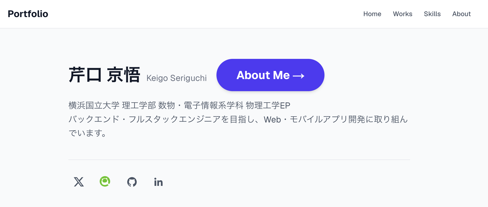

# Portfolio

## 概要

芹口京悟のポートフォリオサイトです。

これまでに制作したプロダクト、技術スキル、経歴やエンジニアとして目指していることを掲載しています。

## 公開URL

[ポートフォリオを見る](https://portfolio-one-navy-86.vercel.app/)

## ページ

- **Home**：プロフィールと各種SNSへのリンク
- **About**：自己紹介、経歴、目指しているエンジニア像
- **Works**：これまでに制作したプロダクトの一覧と詳細
- **Skills**：技術スキルと習熟度

## 技術スタック

| 分類           | 使用技術                                    |
| -------------- | ------------------------------------------- |
| フレームワーク | Next.js 16（App Router）                    |
| UI             | React 19                                    |
| 言語           | TypeScript                                  |
| スタイリング   | Tailwind CSS 4、Tailwind CSS Typography     |
| ヘッドレスCMS  | microCMS                                    |
| コンテンツ表示 | React Markdown、remark-gfm、rehype-sanitize |
